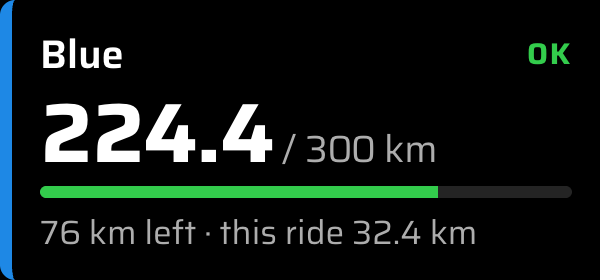
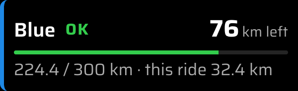
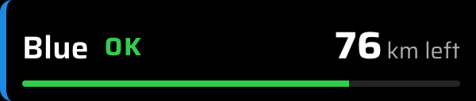
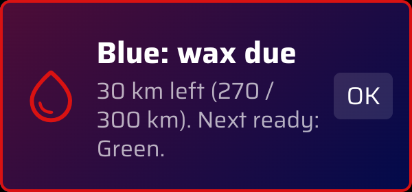
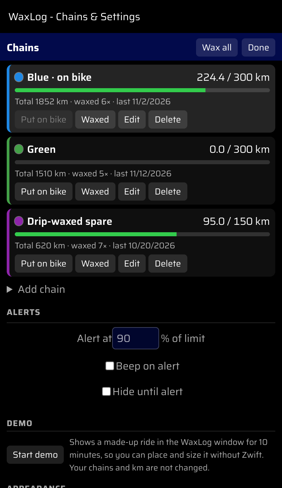

WaxLog for Sauce for Zwift
==========================

A small [Sauce for Zwift](https://www.sauce.llc) mod for riders who wax their chains. It counts
the km you ride in Zwift on the chain that is currently on the bike, and pops up a box on screen
when that chain needs fresh wax. The idea is borrowed from
[Karoo-WaxLog](https://github.com/Zalvato/Karoo-WaxLog).



- **Several chains**, each with a name, a color and its own km limit
- **Switch chains** with "Put on bike". Only the active chain counts km.
- **Waxed** resets the chain's km to 0. Its total km and wax count are kept.
  **Wax all** does that for every chain at once, for when the whole set went in the pot.
- **Fits the window:** the window size decides how much it shows. Drag it flat and you get one
  row (name, status, km left); a bit taller adds the bar, taller still a line with the km since
  waxing (and this ride's km), and with enough room the big box with large km digits and the
  "km left" line under them. When a row gets tight, the chain name is shortened, never the
  status; the colored stripe on the left still tells which chain it is. It only changes when you resize the window,
  never during a ride.

  
  
  
- **Hide until alert** (on by default): the window is fully transparent while the chain on the
  bike is fine and only appears once that chain reaches the alert threshold. Turn it off under
  Alerts to always see it.
- **Colors:** green, yellow within 10 % of the alert threshold, red from the alert threshold
  (90 % by default), and a pulsing outline once you're over the limit. The status is also
  written out (ok / wax soon / wax due / over limit), so it doesn't rely on color alone.
  "Wax due" and "over limit" stand out as red on a white badge, readable on every theme.
- **On-screen alert box** (with an optional beep) when the chain reaches the alert threshold
  and again when it reaches the limit. It names the chain that's ready to go on next. Click
  anywhere on it or press Esc to dismiss.

  
- **Edit** fixes a name, color or limit, or sets the km since waxing by hand (e.g. when you
  start using the mod with chains that are already partly used)
- **Demo** in the settings window shows a made-up ride for 10 minutes, so you can place and
  size the window without Zwift running. Your chains and km are never changed by it.


Install
-------
Sauce loads mods from `~/Documents/SauceMods` ("My Documents" on some systems). Create that
folder if it doesn't exist.

**From the release zip:** download `waxlog-<version>.zip` from
[Releases](https://github.com/mafl2k/waxlog/releases) and put the `waxlog` folder from it into
`SauceMods`. When updating, replace the old `waxlog` folder completely; your chains and km are
kept (they live in Sauce's app settings, not in the folder). Check that `SauceMods/waxlog/manifest.json`
exists. Not `SauceMods/waxlog-<version>/waxlog/...`: Sauce ignores that. On Windows, **Extract
All** adds such a folder unless you change the destination to `SauceMods` itself.

**From a checkout:** clone the repository and copy or symlink the folder into `SauceMods`:

```bash
git clone https://github.com/mafl2k/waxlog.git && cd waxlog
mkdir -p ~/Documents/SauceMods && ln -s "$PWD" ~/Documents/SauceMods/waxlog
```

Start Sauce, enable **WaxLog** in Sauce's Mods settings and restart Sauce when it asks. Then
add the **WaxLog** window (group "[MOD]: WaxLog") from the window list. It's an overlay, so it
sits on top of Zwift.


Use
---
- Click the box (or the tune button in its title bar) to open **Chains & Settings** in its own
  window (420×600), so it stays usable however small you make the overlay. There you add
  chains, put one on the bike, mark waxed, wax all, edit, delete, and set the alert options.
  It updates live while you ride.

  
- **Look:** Sauce paints the WaxLog window like its own windows: theme colors, background
  texture, outline and rounded corners. The **Transparent** themes (e.g. "Dark" under
  Transparent) make it see-through like Sauce's windows, and it shows again while the mouse is
  over it. Under Appearance in the settings window you can override theme and texture for WaxLog
  only. **Solid background** there (the same setting Sauce's windows have) paints the window in
  a color of your choice, with an opacity (slider or number, in %): 100 is opaque, lower values
  let Zwift show through.
  While "Hide until alert" hides the window, it stays invisible whatever you pick here.
- **Demo:** press **Start demo** in the settings window and the WaxLog window shows a made-up
  ride (600 m per second) for 10 minutes, marked **DEMO** with the time left. It is visible
  even with "Hide until alert", and it runs through the alerts, so you can see where they appear.
  Without any chain it uses a sample chain. **Stop demo** ends it early. Meanwhile Zwift data
  is ignored and nothing is saved: the demo km live on a copy of your log. Km you ride in
  Zwift during the demo are not lost; they're counted as soon as the demo ends.
- With "Hide until alert" the window is invisible, but it's still there: hover over where you placed
  it to make it show faintly, then click it to open the settings.
- Right-click the window to show Sauce's title bar so you can move or close it (the row stays
  visible while the title bar is up, so you can see what you're moving).
- An invisible window still catches mouse clicks in its area (Sauce has no click-through for
  mod windows). Put it over a part of Zwift you never click, like the top-left power panel.
- "Waxed", "Wax all" and "Delete" ask for a second click to confirm.


Good to know
------------
- **How it counts:** Sauce passes on Zwift's own distance for the current ride. WaxLog
  remembers how far into that ride it has already counted (a checkpoint) and adds the rest.
  So opening the window mid-ride, closing and reopening it, or a gap in Zwift's data stream
  loses nothing, and several WaxLog windows never count the same km twice.
- A new ride is recognized when Zwift's ride distance or ride time drops, when the sport or
  Zwift account changes, or when much more real time has passed than ride time (over 2 hours).
  Standing still (Zwift's save screen, or in the game without riding) is never a new ride, however
  long it lasts. While the WaxLog window is open and Zwift sends data, WaxLog notes the time
  every 30 min, so resuming the same ride after a long pause doesn't count it twice. One case it
  can't tell apart: Sauce closed for a pause of over 2 hours, and the ride resumed before Sauce
  is started again. Then that ride counts again; fix it with **Edit**.
- **Not counted:** rides done while Sauce isn't running (WaxLog only sees Zwift through
  Sauce, and Sauce doesn't share your lifetime Zwift km). Add those with **Edit**. Zwift
  running km are never counted.
- It counts **your own** rider, not the athlete you're watching.
- **Zwift km are virtual:** coasting down a descent counts as much as a hard climb. As a rough
  start, hot-melt (immersion) wax lasts about 300 km and drip wax about 150 km.
- **One log for all Sauce profiles:** the log is stored in Sauce's app settings on this
  computer (key `waxlog:data:v1`), which every window profile shares. A WaxLog window opened
  through Sauce's web server in another browser uses the same log too (it catches up within
  10 s). Switching profiles in the middle of a ride counts every km once. The WaxLog window and its
  settings show the ride every second, but it's saved only every 5 km and when something
  happens: a new ride starts (e.g. joining an event resets Zwift's distance), an event starts
  or ends, Zwift sends no data for 15 s, you change something in the settings, or the window
  closes or Sauce quits. km not saved yet aren't lost while the ride goes on: the next save
  catches up, also after restarting Sauce in the same ride. A crash loses at most the last
  5 km, and only if that Zwift ride ends before Sauce runs again. The demo's on/off is kept per profile (`waxlog:prefs:v1` in the window's local
  storage).
- **Updating from 0.5 or older:** each profile had its own log before. The first time a
  profile opens WaxLog 0.6, its log is compared with the shared one, and the log with more km
  in total wins. So a profile that started over at 0 km doesn't replace your real log. The
  profile's old log is kept in that profile as a backup (`waxlog:data:v1:profile-backup`).
  Data from version 0.1 is moved over automatically.


Preview without Zwift
---------------------
Serve the folder and open `pages/waxlog.html?demo`. Outside Sauce, the page shows the same
made-up ride as the Demo button (600 m per second), for as long as the page is open, so you
can see the counting and the alerts. Like the Demo button, it never saves anything. The
settings page (`pages/waxlog-settings.html`) works in the browser too, and its Demo button
drives an overlay open in another tab. The core logic has tests:
`node --test tests/core.test.mjs`. `bash scripts/zip.sh` builds the release zip
`dist/waxlog-<version>.zip`.

```bash
python3 -m http.server 8765
```

Then open <http://localhost:8765/pages/waxlog.html?demo>.


Files
-----
| Path | Purpose |
|---|---|
| `manifest.json` | Mod manifest (one overlay window) |
| `pages/waxlog.html` | Overlay window (box + alert) |
| `pages/waxlog-settings.html` | Chains & settings window |
| `pages/src/waxlog.mjs` | Sauce wiring, storage, alerts, UI (`main` = overlay, `settingsMain` = settings) |
| `pages/src/waxlog-core.mjs` | Pure logic: data model, ride checkpoint, levels, demo |
| `pages/css/waxlog.css` | Styles |
| `tests/core.test.mjs` | Tests for the core logic |
| `scripts/zip.sh` | Builds the release zip |
| `docs/images/` | Screenshots for this README |


License
-------
MIT, see [LICENSE](LICENSE).
